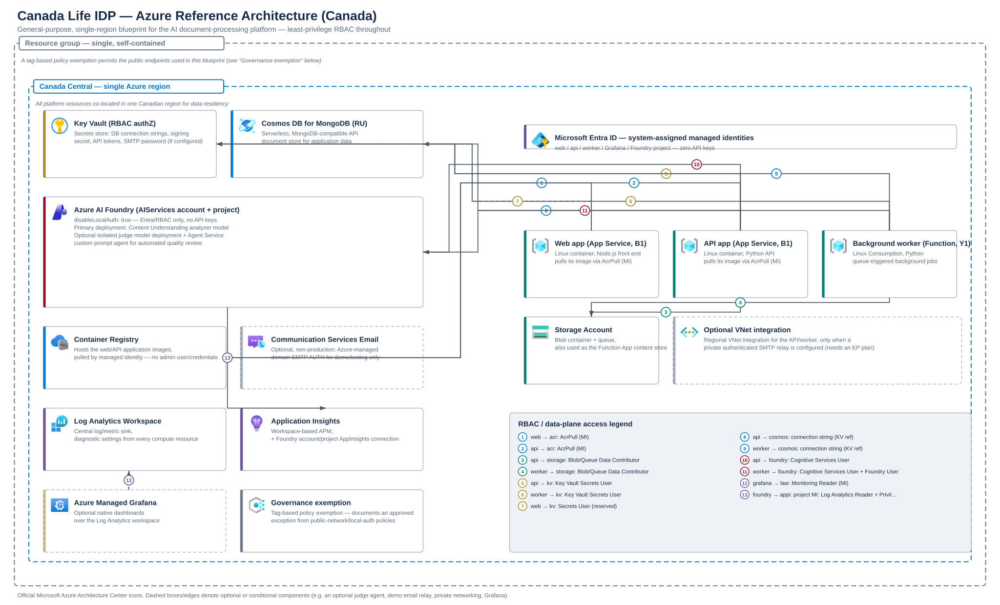

# Azure reference architecture (Canada)

## Purpose

This diagram is a **general-purpose Azure blueprint** for the cl-idp platform, derived from the Bicep in [`infra/`](../../infra/) but intentionally stripped of environment-specific names (resource group, resource instance names, parameter values). It shows what to provision, why, and how the pieces talk to each other — not a specific deployed environment. Unlike [`canada-life-idp-enterprise-architecture.md`](./canada-life-idp-enterprise-architecture.md), which describes an aspirational **TARGET ENTERPRISE** design with AKS/Service Bus/APIM, this is the leaner, single-region shape the current codebase actually needs.

All resources live in a **single Canadian Azure region** (Canada Central) for data residency, inside one self-contained resource group.

## Diagram



The editable source is [`canada-life-idp-azure-production-topology.excalidraw`](./canada-life-idp-azure-production-topology.excalidraw) — a native Excalidraw scene (drag it into [excalidraw.com](https://excalidraw.com) or the VS Code Excalidraw extension to edit). Both files are generated from a single declarative layout by [`generate-azure-production-topology-diagram.mjs`](./generate-azure-production-topology-diagram.mjs); re-run it after any `infra/` change:

```sh
node docs/architecture/generate-azure-production-topology-diagram.mjs
```

## What's shown

- **Compute tier** (independently scalable): a web app and an API app (App Service, Linux containers) each on their own plan, plus a Consumption Function App for queue-triggered background processing. All three use **system-assigned managed identities** — no secrets or keys are embedded in app code.
- **Data tier**: a Storage Account (blob container + queue, also used as the Function App's content store) and a Cosmos DB for MongoDB account (serverless, MongoDB-compatible API) for application data.
- **Security tier**: a Key Vault (RBAC-authorized) holding connection strings, a signing secret, API tokens, and an optional SMTP password — no component resolves secrets any other way.
- **AI tier**: an Azure AI Foundry account + project with `disableLocalAuth: true` (Entra ID/RBAC only), hosting a Content Understanding analyzer deployment, plus an **optional** isolated judge model deployment and Agent Service prompt agent for automated quality review; and a Container Registry hosting the application images, pulled via `AcrPull` on the compute identities (no admin user/credentials).
- **Observability**: a Log Analytics Workspace and workspace-based Application Insights, with diagnostic settings streaming logs/metrics from every compute resource, plus an AppInsights connection on the Foundry project for agent tracing. **Optional** Azure Managed Grafana reads from Log Analytics via its own managed identity — no API keys.
- **Optional/non-production**: Azure Communication Services Email as a demo-only SMTP relay, and an optional regional VNet integration subnet for a private authenticated SMTP relay (requires an Elastic Premium plan on the worker).
- **RBAC edges** (numbered on the diagram, detailed in the legend panel): each compute identity is granted only the data-plane roles it needs — the API/worker get *Storage Blob/Queue Data Contributor*, *Key Vault Secrets User*, and *Cognitive Services User*; the worker alone additionally gets **Foundry User** (for the judge Agent Service); the web/API apps get `AcrPull` on the registry; the web app only holds a reserved *Key Vault Secrets User* grant for future use; Grafana's identity gets *Monitoring Reader* on Log Analytics; the Foundry project's identity gets *Log Analytics Reader* + *Privileged Monitoring Data Reader* on Application Insights. No component uses account keys or API keys for cross-resource access.
- **Governance exemption**: a tag-based policy exemption documents an approved exception from Modify-effect policies (public-network access, local auth) that would otherwise force private-only networking incompatible with this blueprint's public reachability — called out explicitly as its own node rather than left implicit.

## Region note

This blueprint assumes a **single Canadian region** end-to-end. (The actual deployed environment this blueprint is derived from splits compute and data/AI across two regions due to a subscription-specific compute quota constraint — see [`infra/README.md`](../../infra/README.md) if you need that history. As a general blueprint, assume sufficient quota and keep everything in one region.)

## Relationship to the enterprise target

This is the **lean, single-region shape**, not the **TARGET ENTERPRISE** design. It intentionally omits AKS, Service Bus, private networking/APIM, and MongoDB Atlas — those remain future-state per the enterprise architecture document. This blueprint reflects what the current codebase needs to run end-to-end with least-privilege RBAC and no local-auth fallbacks where avoidable.
