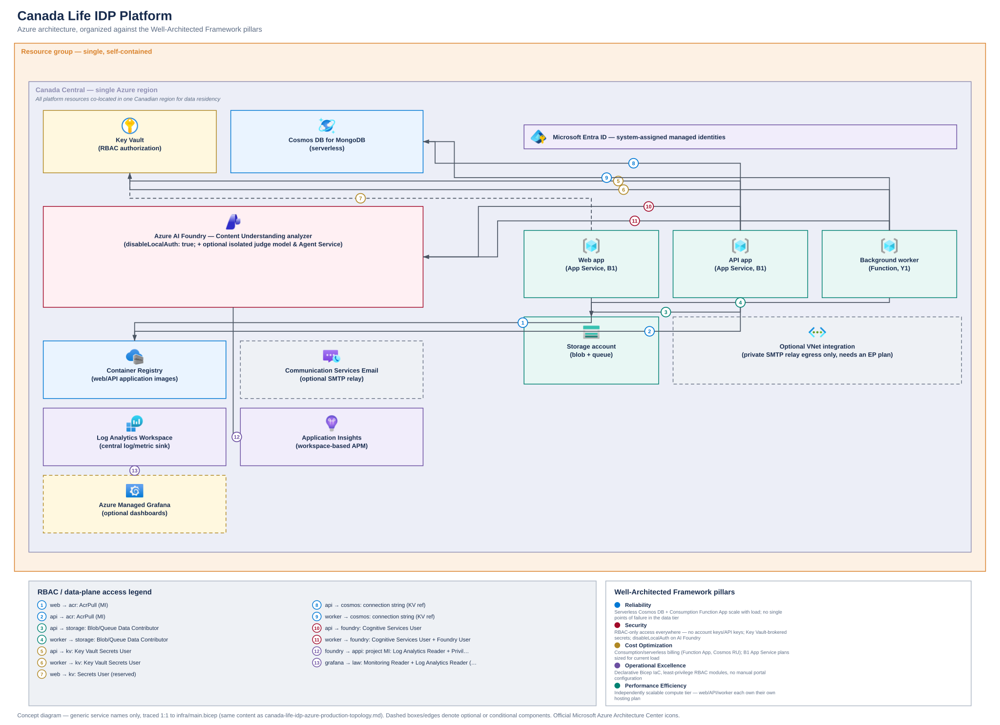

# Concept Azure Well-Architected Framework diagram (Canada)

## Purpose

This diagram shows **the same real, deployed architecture** as
[`canada-life-idp-azure-production-topology.md`](./canada-life-idp-azure-production-topology.md) —
traced 1:1 to [`infra/main.bicep`](../../infra/main.bicep) and its modules — redrawn in the Azure
Architecture Center's nested-boundary visual style and organized against the five
[Azure Well-Architected Framework](https://learn.microsoft.com/azure/well-architected/) pillars. It
is **not** a different or aspirational architecture; it's the same resource/RBAC list as the
production-topology doc, with a different look (solid pastel boundaries, icon-over-label nodes, a
numbered RBAC legend) and a pillar-oriented framing. The **monitoring/observability tier** (Log
Analytics, Application Insights, optional Managed Grafana) is intentionally left out of this
diagram to keep it focused on compute, data, security, and AI — see the production-topology doc for
those.

All resources are shown in a single Canadian region box for simplicity. In the real deployment,
most resources default to `canadaeast` for compute (`computeLocation`) while a handful default to
`eastus2` (`location`) for historical subscription-quota reasons — see the "Region note" in
[`infra/README.md`](../../infra/README.md). Neither region split nor this abstraction affects what
services exist or how they're wired together, which is what this diagram documents.

## Diagram



The editable source is [`canada-life-idp-azure-waf-architecture.excalidraw`](./canada-life-idp-azure-waf-architecture.excalidraw) (drag into [excalidraw.com](https://excalidraw.com) or the VS Code Excalidraw extension). Both files are generated from a single declarative layout by [`generate-azure-waf-architecture-diagram.mjs`](./generate-azure-waf-architecture-diagram.mjs):

```bash
node docs/architecture/generate-azure-waf-architecture-diagram.mjs
```

Re-run this after any change to `infra/main.bicep` so the diagram stays accurate.

## What's shown

- **Resource group** (single, flat, no VNet/subnets beyond one optional outbound-only integration
  subnet): everything below lives in one resource group — there is no hub-spoke network, firewall,
  Application Gateway, or Bastion in this deployment.
- **Compute tier**: a Web app and an API app (App Service, Linux containers, B1 plan) and a
  Background worker (Function App, Consumption/Y1, queue-triggered) — each with its own
  system-assigned managed identity (Microsoft Entra ID banner), no shared/service-principal secrets.
- **Data tier**: a Storage account (blob + queue, also the Function App's content store) and Cosmos
  DB for MongoDB (serverless) — both accessed only via managed identity + RBAC, with the connection
  string delivered to app settings as a Key Vault reference, never embedded directly.
- **Security**: Key Vault (RBAC authorization) holding connection strings, the JWT signing secret,
  the service API token, and (optionally) an SMTP password — referenced by apps via
  `@Microsoft.KeyVault(SecretUri=...)`, not copied into configuration.
- **AI tier**: Azure AI Foundry / Content Understanding (Cognitive Services account + project,
  `disableLocalAuth: true`) for document analysis, with an optional isolated judge model and Azure
  AI Agent Service — worker-only, reachable by managed identity (`Cognitive Services User` +
  `Azure AI Foundry User`).
- **Container Registry**: holds the web/API container images; both apps pull via `AcrPull` through
  their managed identity — no registry admin credentials.
- **Optional/conditional components** (dashed in the diagram): Communication Services Email
  (optional SMTP relay, gated by `enableAcsEmailDemo`) and an outbound-only VNet integration subnet
  reserved for a private authenticated SMTP relay (requires upgrading to an Elastic Premium plan).
- **RBAC / data-plane access legend**: every arrow is a real role assignment from
  `infra/main.bicep`'s `rbacLocal`/`rbacCu`/`rbacAiAgents`/`rbacAcr` modules, numbered on the
  diagram and spelled out in the legend panel instead of as inline text (keeps the dense RBAC mesh
  readable).
- **WAF pillar summary panel**: a short note per pillar (Reliability, Security, Cost Optimization,
  Operational Excellence, Performance Efficiency) describing how this specific, lean deployment
  satisfies it — e.g. serverless/consumption billing for Cost Optimization, RBAC-everywhere +
  Key Vault-brokered secrets for Security.

## Explicit non-goals

- **No AKS, API Management, Service Bus, Event Grid, Application Gateway, Azure Firewall, Bastion,
  or private-endpoint subnets** — none of these exist in the current codebase. They only appear,
  clearly labeled as a future-state target, in [`canada-life-idp-enterprise-architecture.md`](./canada-life-idp-enterprise-architecture.md).
- **No monitoring/observability tier** — out of scope for this diagram by request; see
  [`canada-life-idp-azure-production-topology.md`](./canada-life-idp-azure-production-topology.md)
  for how Log Analytics, Application Insights, and Grafana fit into the real deployment.
- **Not a different architecture from the production-topology doc** — same nodes, same RBAC edges,
  same source of truth (`infra/main.bicep`); only the visual style and pillar framing differ.
