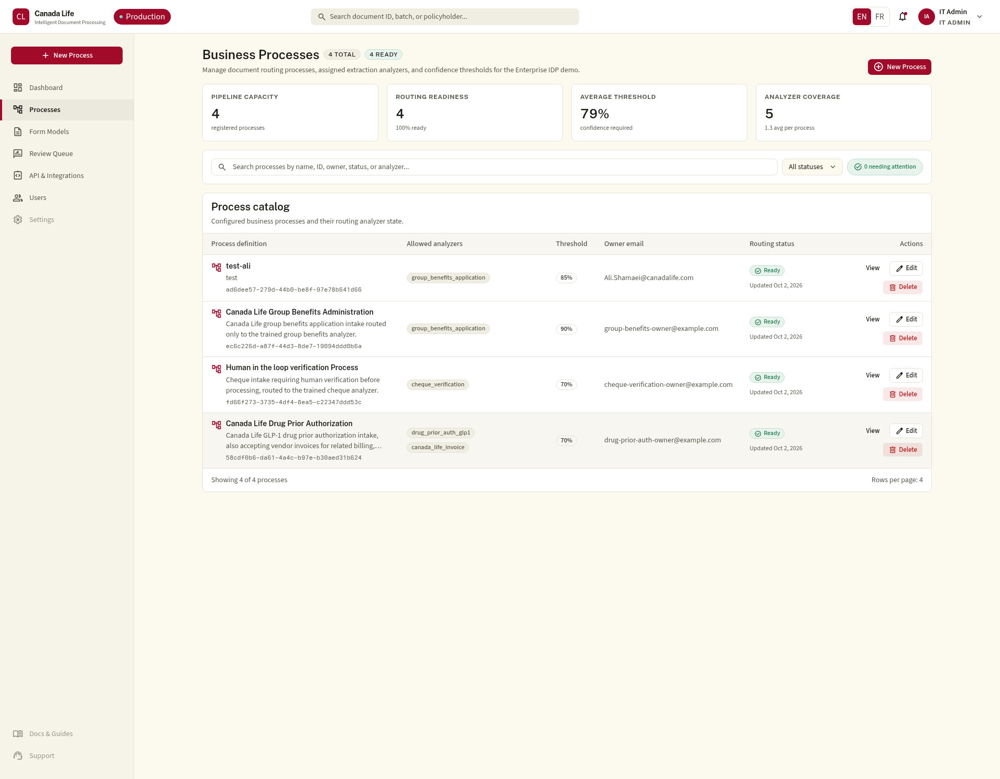
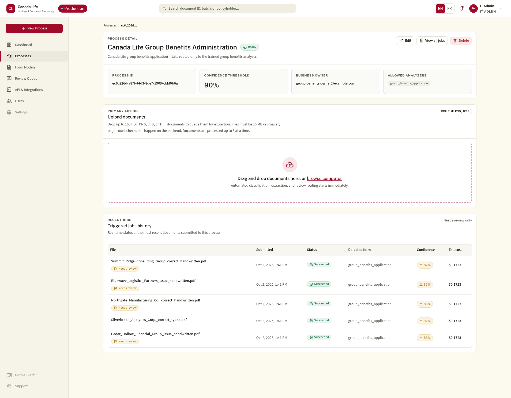
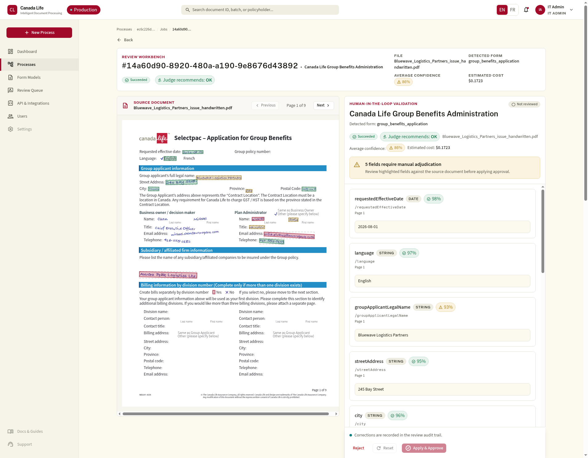
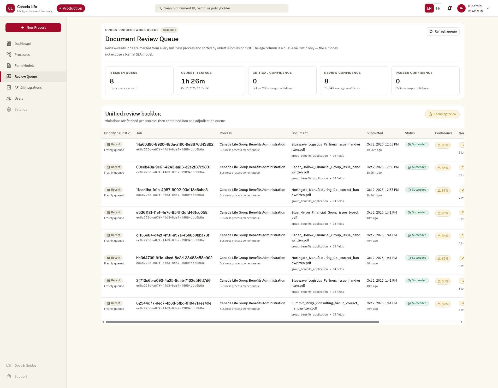
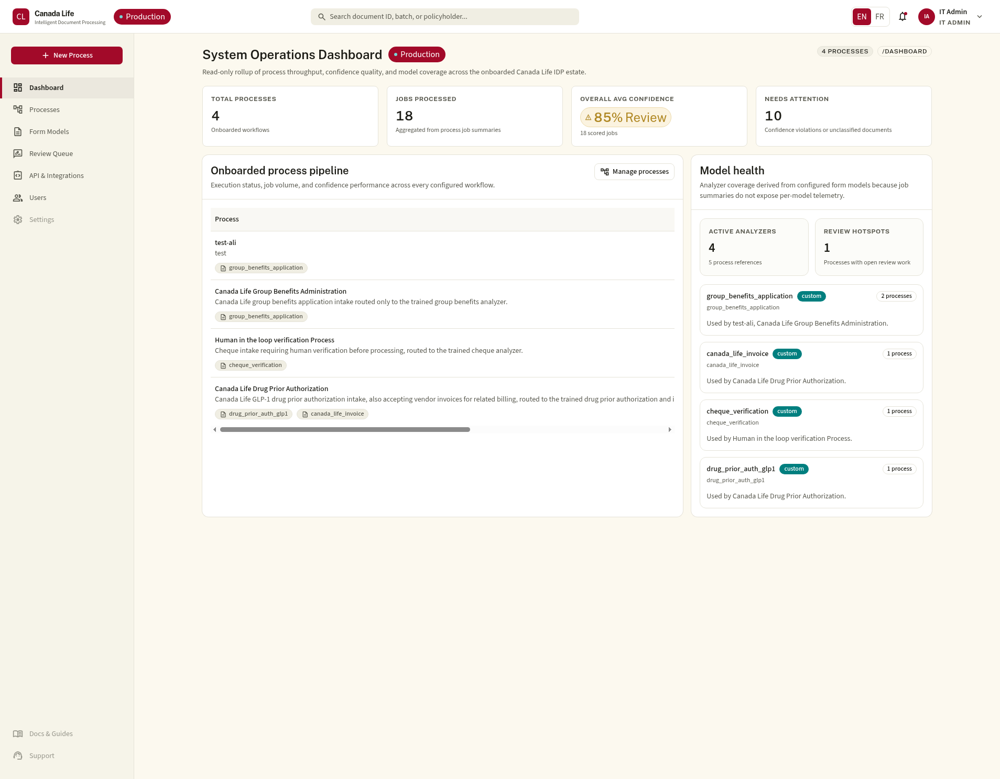
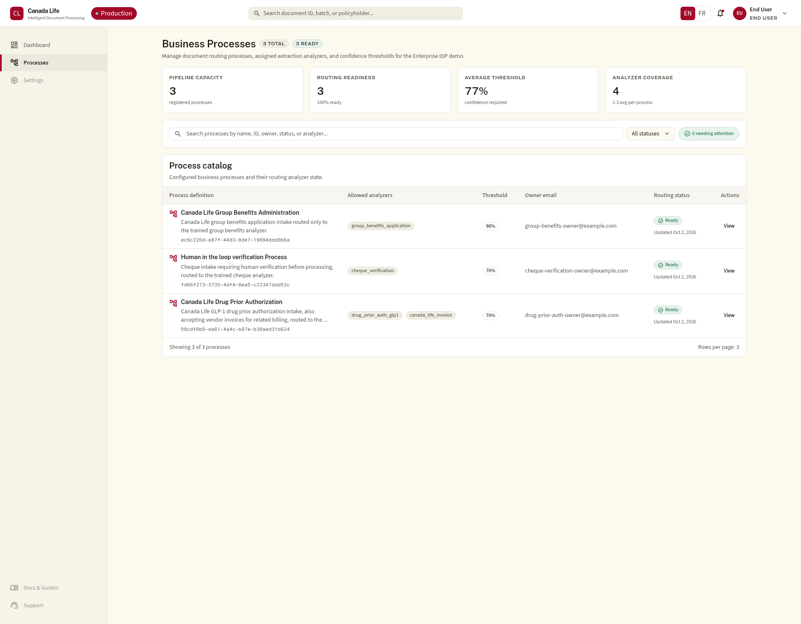
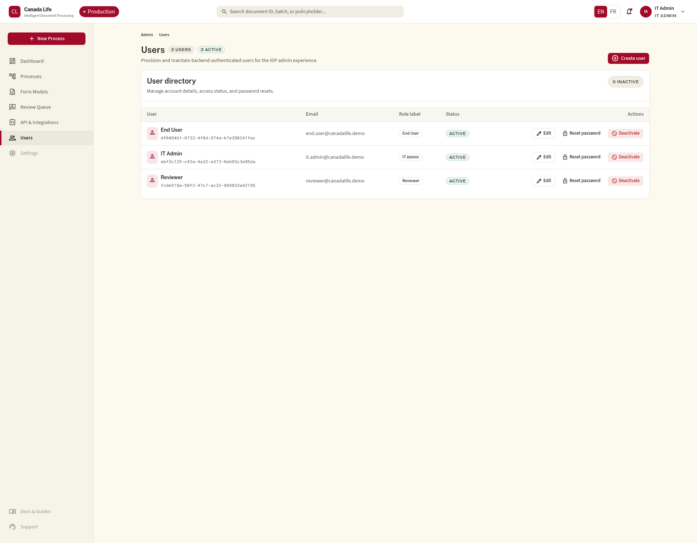

<!-- _class: lead -->

# Canada Life IDP
## Intelligent Document Processing, built for the enterprise

:page_facing_up: :robot: :bar_chart:
*Screenshots in this deck are captured live from the running production environment.*

---

## The Problem

- Manual document intake slows business processes down
- Hard to track **cost**, **accuracy**, and **status** per document
- No unified view across document types or business lines

---

## What It Is

**Canada Life IDP** automates document intake and extraction with
Azure AI Content Understanding — end to end, trigger to reviewed result.

- FastAPI backend (trigger/query API + async queue worker)
- Next.js frontend (process list → detail → upload → review)
- Azure-compatible local emulators for fast, realistic dev loops

---

## Business Processes, at a Glance



- Each intake workflow is a **business process**: analyzer(s),
  confidence threshold, owner
- Live routing status per process
- 4 processes onboarded today

---

## Upload & Trigger



- Drag-and-drop up to 100 documents per process
- Classification, extraction, and review routing start on upload
- Status, detected form, confidence & cost tracked per job

---

## Human-in-the-Loop Review



- Source document + extracted fields, side-by-side
- Field-level confidence, flagged below-threshold fields
- **AI Judge** recommends Approve/Reject
- Reviewer corrects → **Apply & Approve**, fully audited

---

## Unified Review Queue



- Cross-process backlog in one adjudication queue
- Prioritized by confidence tier & age
- One queue, not per-process hunting

---

## Operations Dashboard



- Processes, jobs processed, avg confidence
- "Needs attention" rollup across workflows
- Model health: analyzers & usage per process

---

## Role-Based Personas



Three seeded demo roles, each with a scoped nav:

- **IT Admin** — processes, review queue, users, integrations
- **Reviewer** — review queue + job history
- **End User** — upload only (view shown here)

---

## User Administration



- IT Admin provisions/deactivates users, resets passwords
- Backend-authenticated accounts, scoped by role
- Same RBAC enforced on every API call, not just UI

---

## Observability Built In

Two pre-provisioned Grafana dashboards, beyond the in-app views:

- **CL-IDP — Operations**: request rate/latency, worker throughput,
  processing volumes & p95 latency per pipeline stage
- **CL-IDP — FinOps**: cost per process/form type, burn rate, forecast,
  pages processed, notification spend

Drill into any single job via Tempo traces + Loki logs by `correlation_id`.

---

## Architecture at a Glance

- `apps/api` — FastAPI trigger/query API + worker
- `apps/web` — Next.js UI (Tailwind + shadcn/ui)
- `packages/shared` — generated OpenAPI TS client
- `infra` — Bicep IaC for Azure production
- Local stack: MongoDB/Cosmos, Azurite, Mailpit, Grafana LGTM

---

<!-- _class: lead -->

# Try it locally
```bash
docker compose up -d
cd apps/api && uv run uvicorn app.main:app --reload --port 8000
cd apps/web && npm run dev
```

:point_right: See `README.md` and `DEMO.md` for the full walkthrough
